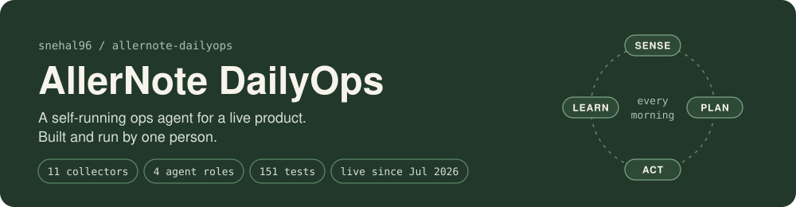
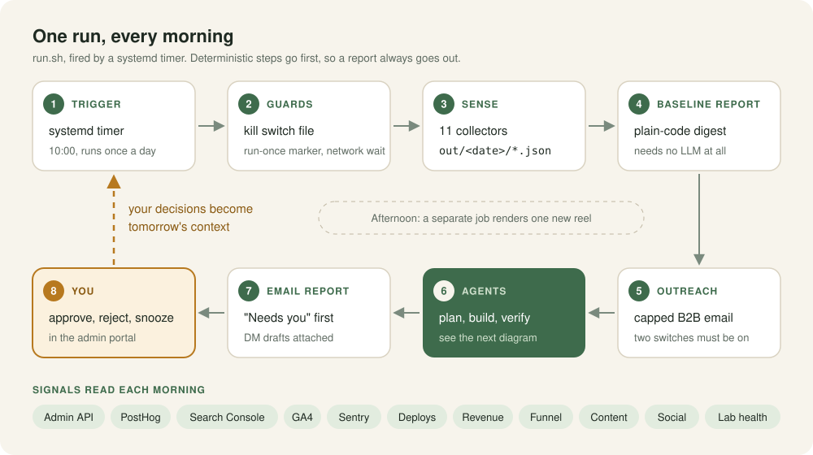
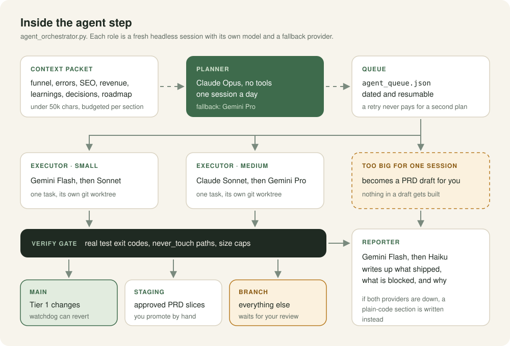
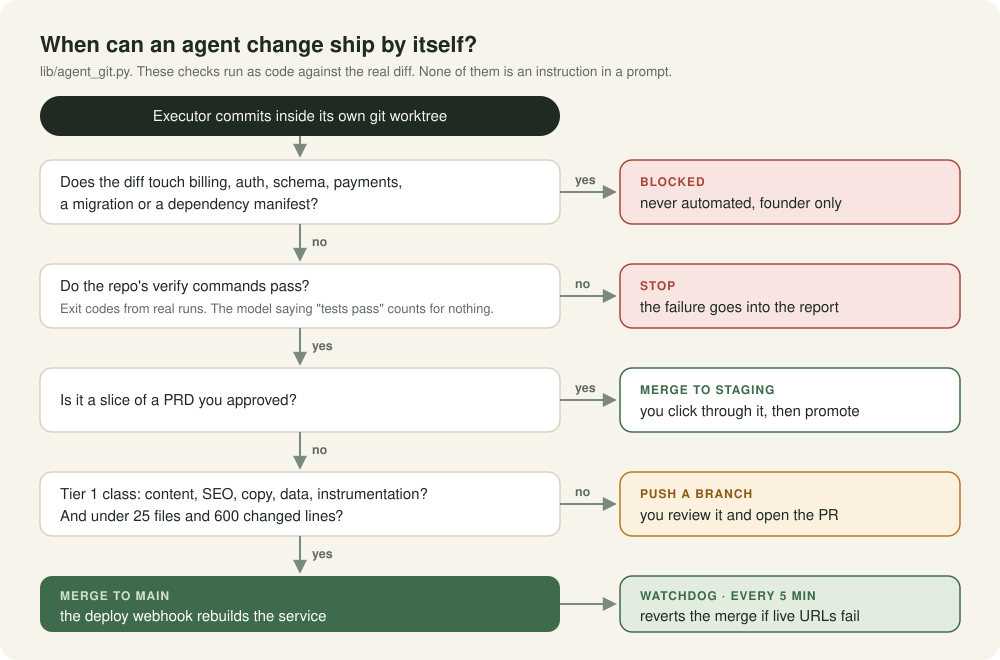
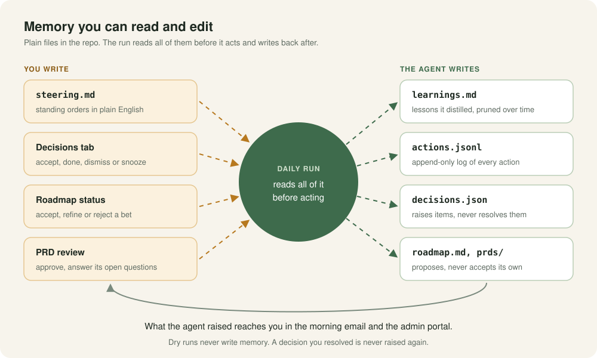
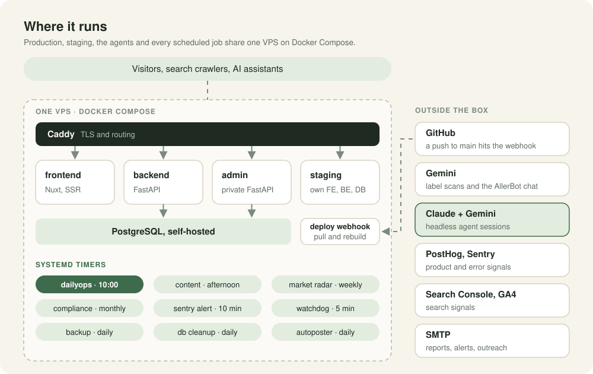
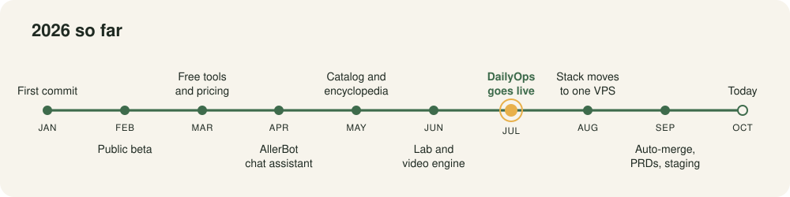

  

  <a href="https://allernote.com">allernote.com</a> ·
  <a href="docs/daily-run.md">The daily run</a> ·
  <a href="docs/orchestration.md">Orchestration</a> ·
  <a href="docs/guardrails.md">Guardrails</a> ·
  <a href="docs/memory.md">Memory</a> ·
  <a href="docs/lessons.md">Lessons</a>

[AllerNote](https://allernote.com) helps people with contact allergies check cosmetics and household products against the allergens their dermatologist found in a patch test. I build it alone. That means the product, plus the work that normally needs a small team around it: watching metrics, triaging errors, fixing SEO, writing outreach, shipping small fixes, making content.

**DailyOps** is the system that does that work. Every morning it reads the product's signals, writes me a ranked report, sends a capped batch of outreach, and has AI agents ship small verified code changes. The decisions stay with me: what to build, what to approve, what never gets automated.

This repo explains how it works and what broke on the way. The production code lives in private repos. The snippets here are trimmed excerpts from them.

## At a glance

| | |
|---|---|
| **Running since** | 1 July 2026, every morning, unattended |
| **Size** | ~10.5k lines of Python and shell, 151 tests |
| **Signals** | 11 collectors: product DB, PostHog, Search Console, GA4, Sentry, deploys, revenue, funnel, content, social, Lab |
| **Agent roles** | Planner, small executor, medium executor, reporter, split across Claude and Gemini with automatic fallback |
| **Reach** | Can change 6 repos (frontend, backend, admin, lab, lab-backend, infra). Merges only what passes the gate |
| **Hosting** | Production, staging, agents and 9 scheduled jobs on one VPS |
| **Product** | 7 repos, ~890 commits since January 2026 |

## One run, every morning

The run is a shell script fired by a systemd timer. The order matters. Everything that doesn't need a model runs first: the guards, the 11 collectors, and a plain-code report built from their JSON. If every LLM provider is down, I still get a useful report. The agents only add to it.

Outreach runs before the agents so the report can say what went out. The email puts **"Needs you"** at the top: decisions waiting on me, branches waiting for review, errors the agent couldn't classify. I answer in the admin portal, and those answers are the first thing the next run reads.

More in [docs/daily-run.md](docs/daily-run.md).

## Inside the agent step

One session doing everything (judge the data, edit four repos, rewrite the report) kept losing the plot. So the step is now split into roles. Each one is a fresh headless session with a single job:

| Role | Primary | Fallback | Why this model |
|---|---|---|---|
| Planner | Claude Opus | Gemini Pro | Judgment is the scarce part. One session a day, no tools, only a budgeted context packet |
| Executor (small) | Gemini Flash | Claude Sonnet | Cheap and fast for copy, SEO and data edits |
| Executor (medium) | Claude Sonnet | Gemini Pro | Multi-file changes that need care |
| Reporter | Gemini Flash | Claude Haiku | Summarising is cheap work. If both are down, plain code writes the section |

The planner writes a dated `agent_queue.json`. A retry resumes that queue, so a crash halfway through never pays for a second plan and never repeats finished work. Each executor gets exactly one task and its own `git worktree` built from `origin/main`. Its only git command is `commit`. The orchestrator owns branching, verifying, pushing and merging.

More in [docs/orchestration.md](docs/orchestration.md).

## When can a change ship by itself?

This is the part I care about most. The rules are code that runs against the actual diff, because a prompt is a request and a check is a guarantee.

- **Never automated:** billing, auth, schema, payments, migrations, dependency manifests. A diff that touches any of them is blocked, whatever the model claims.
- **Tests are run, not reported.** The orchestrator runs each repo's verify commands as real subprocesses. The model's own "tests pass" counts for nothing.
- **Tier 1 merges itself:** content, SEO, copy, data and instrumentation changes under 25 files and 600 lines go to `main`, which deploys. The watchdog checks the live URLs every 5 minutes and reverts an agent merge from the last 45 minutes if they start failing.
- **Approved PRD slices go to staging**, a real second deployment with its own database. Promoting to production is a manual merge.
- **Everything else is a branch** that waits for me.
- **Kill switch:** `touch .disabled` and the next run does nothing.

More in [docs/guardrails.md](docs/guardrails.md).

## Memory you can read and edit

The agent's memory is plain files in git, not a vector store. I write `steering.md` (standing orders in plain English) and resolve decisions. The agent writes `learnings.md` and an append-only `actions.jsonl`. It can raise decisions and propose roadmap items or PRDs. It can never resolve or accept them.

Two rules keep this from rotting. Dry runs never write memory, so testing the pipeline can't teach it anything false. And decisions have stable keys like `sentry:<issue_id>`, so once I've dismissed something it is never raised again.

More in [docs/memory.md](docs/memory.md).

## Where it runs

In August I moved everything onto one VPS running Docker Compose: Nuxt frontend, FastAPI backend, the private admin app, a staging copy, self-hosted Postgres, and the agents. A push to `main` hits a small deploy webhook that pulls and rebuilds the service. Nine systemd timers run the scheduled work: the daily run, an afternoon content job, a weekly market radar, a monthly compliance radar, Sentry alerts, the watchdog, backups, DB cleanup and the social autoposter.

The watchdog sends email with plain `smtplib` on purpose. It has to keep working when the backend is the thing that's broken.

## Things that broke, and what changed

Most of what's interesting here came from failures. A few of them:

- **The run vetoed itself every day.** The box runs on UTC and the schedule is in my local time. The "don't run before 10:00" guard compared the two and decided every 10:00 run was early. Fix: compute every time-based value in one configured timezone.
- **Production files made every task look unsafe.** The running services rewrite tracked files, so `git status` was never clean, and the "dirty tree, stop" rule blocked every frontend and admin task for days. Fix: executors work in throwaway worktrees and never touch the production checkout.
- **A red gate on `main` blocked auto-merge for two weeks.** `npm run typecheck` was already failing on `main`, so no frontend task could ever pass, and nothing reported why. Fix: get `main` green, and make newer gates (like the UI audit) judge only the files a branch touched. A gate nobody can pass ends up switched off.
- **The planner was reading a truncated packet.** A 53k-char decisions dump pushed funnel, Sentry and revenue data out of the context, and nothing said so. Fix: per-section budgets, plus a test that asserts they sum below the cap.
- **Instruments that read zero.** Five times a metric reported 0 because an event was missing, not because nobody did the thing. That's why instrumentation is now in the auto-merge tier.
- **Staged fixes rotted.** Branches sat unpushed for 9 days while the problem they fixed kept costing traffic. The agent's own lesson was "a fix that isn't pushed is worth zero", and that is where Tier 1 auto-merge came from.

Full write-ups in [docs/lessons.md](docs/lessons.md).

## 2026 so far

## The product it runs

AllerNote itself, for context:

- **Label scanning.** Photo of an ingredient list, then extraction with Gemini, then matching against the user's allergen list, including synonyms and cross-reactors. In an eval on real failed images, a *smaller* model hallucinated fewer ingredient lists than the larger one, so production runs the smaller one.
- **AllerBot**, a tool-using chat assistant over the catalog and ingredient data. When I looked at real traffic, about 90% of its "conversations" turned out to be crawlers following auto-firing links. That changed how I measure it.
- **~4,500 product pages and 163 ingredient pages**, each with allergen analysis rendered on the server so search engines and AI assistants can read it.
- **Lab**, a separate service for dupe and shade matching tools.
- **A video engine** in Remotion that turns a topic into rendered short-form reels for each platform. DailyOps runs it every afternoon.

## Stack

**Product:** Nuxt 4 / Vue 3, FastAPI, PostgreSQL, Gemini, Caddy, Docker Compose 
**Agents:** Claude Code (headless), Antigravity, Python orchestration, git worktrees, systemd 
**Signals:** PostHog, Sentry, Google Search Console, GA4 
**Content:** Remotion, Google Cloud TTS

## How I work

Most of the code across these repos was written by AI agents. My job is deciding what gets built, writing the rules the agents run under, reviewing what they ship, and fixing the system when it fails. This repo is mostly about that last part.

If you're building something similar, or want to talk about agent systems in production, open an issue or find me via my [GitHub profile](https://github.com/snehal96).
